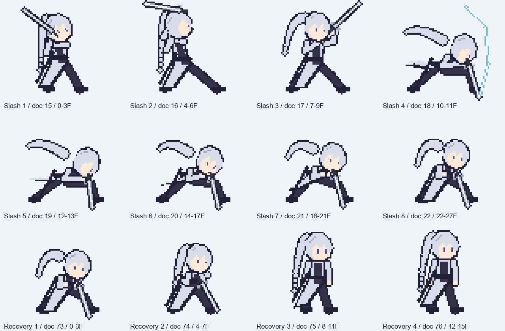

# 1段目「縦斬り」の作画ガイド（2026-10-13）

**2026-10-16 仮提出を受領：** 今回は `Player_attack_1.aseprite` の9コマ×70msをそのまま使い、128×128/32PPU/Pivot(32,38)、命中17F/次段34Fへ合わせた。後ろ髪と復帰は今回の動画の前提にしない。[受領版のコマ表と動画接続](attack1-submission-and-heel-drop.md)を正とし、以下の8コマ/10F/22Fは旧ラフを説明する履歴として残す。

編集元は `Assets/Art/Player/VideoRough/Player_actions_rough.aseprite`。`VerticalSlash` と `Recovery_VerticalSlash` を選ぶ。最初の14コマは元idle/walkの非表示参照。別名 `Player_actions_clean.aseprite` に保存し、CleanUpレイヤーへ描く。原素材とラフのファイルは保持する。

## コマの役割

Fは開始を0とした60Hzの戦闘フレーム。絵の「8コマ」と、動作時間の「28F」を区別する。表示msはAsepriteの丸め値で、Unityでは整数Fを使用する。1段目は上から前下へ振る縦斬り。

| 絵 | Aseprite文書コマ | 戦闘F | 表示F / ms | 役割と動き | 描く時の注意 |
|---|---:|---:|---:|---|---|
| 1 | 15 | 0–3 | 4F / 67ms | 待機から刀を後ろ上へ持ち上げ、足を開き始める | 最初から全力で低くしない。既存待機の体格・頭の大きさ・装備から入る |
| 2 | 16 | 4–6 | 3F / 50ms | 最大の溜め。頭/肩を後ろへ、刀を頭の後ろ上へ、後ろ脚に荷重 | 刀の先端と頭を分離。胸と腰のひねり、曲げた膝で溜めを示す |
| 3 | 17 | 7–9 | 3F / 50ms | 加速の中間。重心が前脚へ移り、肩/肘/刀が前上を通る | 2→4の軌道をつなぐ。ここを2枚目とほぼ同じ絵にすると振りが消える |
| 4 | 18 | 10–11 | 2F / 33ms | 命中。頭/肩を前下へ運び、前膝を深く曲げ、刀を前下へ振り抜く | 最重要の絵。10Fで1回ダメージ。命中停止中もこの絵が残る。前脚が支え、顔/手/刀が潰れない輪郭にする |
| 5 | 19 | 12–13 | 2F / 33ms | 命中後の振り抜き。頭/腰が少し下がり、刀が最下点へ。髪/上着が遅れて流れる | 4から逆向きに刀を戻さない。刀を地面へ刺したようにしない |
| 6 | 20 | 14–17 | 4F / 67ms | 減速。低い構えを維持し、肘を緩め始める | 14Fでコンボ受付と防御キャンセルが開く。まだ通常立ちへ戻さない |
| 7 | 21 | 18–21 | 4F / 67ms | 振り終わりを受け止め、肩/腰を少し戻して次の動作へ | 前脚の荷重を残す。20Fで遅いキャンセル受付、21Fでコンボ受付終了 |
| 8 | 22 | 22–27 | 6F / 100ms | 低い終端構え。横斬り開始/自由な復帰の共通の接続姿勢 | 実機では22Fに次段か復帰へ切り替える。8枚目の6Fを丸ごと待つとは限らない。横斬り1枚目と復帰1枚目はこの姿勢を共用 |

10Fの命中には2Fの軽いHitstopが別に加わる。絵の表示時間を延ばして停止を二重に付けない。攻撃Clipには28Fの終了Eventもあるが、通常のこの撮影設定は22FのRecovery Eventで次段か自由な復帰へ移る。

## 無入力時の復帰

`Recovery_VerticalSlash` の文書73–76コマ、4枚×4F＝16F（約0.267秒）。この時計は復帰開始から0F。

| 絵 | 戦闘F | 役割 |
|---|---:|---|
| 1 / 文書73 | 0–3 | 縦斬り8枚目の低い終端姿勢を保つ |
| 2 / 文書74 | 4–7 | 刀と肩を緩め、膝を伸ばし始める |
| 3 / 文書75 | 8–11 | 足幅/腰/肩を待機の形へ寄せる。髪や上着は少し遅れる |
| 4 / 文書76 | 12–15 | 提供済み待機の立ち姿へ揃える。体の大きさ/接地が飛ばない |

復帰は無入力時の表示で、歩き・攻撃・パリィなど全行動の入力でキャンセルできる。コンボ入力があれば復帰を挟まない。長い被弾硬直のように描かず、途中から別の行動へ移っても不自然でない姿勢にする。

## 先に揃える絵

最初は2（最大溜め）・4（命中）・8（終端）・復帰4（待機）の4枚で方向/体格/重心を揃える。次に3と5で速い軌道をつなぎ、最後に1・6・7と復帰の中間を描く。全体の線を細かく仕上げる前に、通常速度の8枚を通して見る。

- 64×64、右向き、透過、約3頭身。左右反転はUnityが行う。頭を小さくして身長を稼がず、元idle/walkと同じ人物へ揃える。
- 足裏は上端から57〜58行が基準。Unity Pivotは下端から(32,38)px。前脚の足裏を床から浮かせたり、全コマを縦へずらして位置補正しない。
- 前進0.12unit（約3.84px）は最初の10Fでコードが移動する。絵のキャンバス内では踏み込みの姿勢を描き、同じ移動を全身の平行移動でも付けない。敵の0.10unitのヒットバックも実装側。
- 刀は握った手からつなぐ。柄/鍔/刀身がコマごとに伸縮しすぎないようにする。現在のラフの関節/角度は動きの目安で、輪郭や人体の歪みをそのまま写す必要はない。
- 顔/前腕/前脚の間に隙間を残す。命中で頭・腕・刀が一つの塊になると、止めても何が当たったか読めない。
- 接触火花/Flash/画面揺れはコードとVFXの担当。主人公のCleanUpへ塗り込まない。剣の短い軌跡を描く場合は武器レイヤーに分ける。
- Actionタグ・表示時間・10Fの命中境界・22Fの分岐を維持するのが最短の接続方法。追加コマや時刻変更も可能だが、変更したコマ/合計Fを知らせるとCodexが判定/移動/Clipを合わせ直せる。

## 1段目だけの受け渡し

`VerticalSlash` 8枚＋`Recovery_VerticalSlash` 4枚の12枚が揃ったら、その時点で.asepriteを渡してよい。全アクションの完成を待たず、Codexが部分統合して足/刀/接触・横斬りへのつながりを実機で確認する。

`Tools/Art/export-player-clean.lua` に `only=VerticalSlash,Recovery_VerticalSlash` を渡すと2タグだけを書き出せる。次回以降は完成済みのタグをすべて列挙して出力する。未指定タグはラフを使い、古いPNGはmanifest外として無視する。選んだタグの欠落/空コマは拒否する。書き出しやUnity設定の作業はCodex側で行う。
