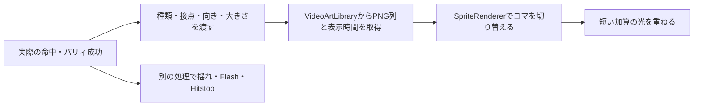

# 現在のVFXの仕組みと作画・調整ガイド

2026-10-19時点の撮影Scene/Studioを基準にする。提案値は制作開始用であり、現在の実装値と区別する。

## おすすめする改善

現在の電撃衝撃波は、ほぼ均等な二重円と細い放射線が拡大する。追加放電も8方向へ同程度の太さで伸びるため、足の運動方向より円の図形が目に入りやすい。これは現在の画像を見てのデザイン上の評価であり、描画の不具合ではない。

まず **「斜めの太い衝撃形→欠けた衝撃波→少量の放電と破片」** へ作り直す案を推奨する。

1. 接点に小さい白い芯を置き、足の振り下ろし/敵の吹っ飛ぶ方向へ伸びる太いくさびを1〜2動画Fだけ出す。中心の白を広げすぎず、足と敵の輪郭の一部を残す。
2. 次に大きく欠けた半円・斜めの三日月へ広げる。周囲を等間隔の線で囲まず、太い部分と空白を作る。最初の2枚で大きく形を変え、後半は広がりを弱める。
3. 雷は主枝1〜2本と短い枝2〜3本に絞る。足元から接点、接点から吹っ飛ぶ側へつなぐ。全方位に同じ長さの枝を置かない。枝の形はコマごとに飛ばして切り替え、滑らかな移動より断続的な放電にする。
4. 破片/火花は1〜2F遅れて外へ飛ばし、最後に少数を残す。太い本体、細い電気、小さい破片の大中小を作る。
5. 発光は命中の短いピークへ集中させる。全編を明るくするとタメと命中の差が減る。白背景では青紫の縁と濃い中間色が形を支える。

静電気のバチバチは、脚の近くに短い折れ線を不規則に2〜4本置き、1コマ出す→次は消す/別の位置に出す、を基本にする。輪郭を常に電気で囲むより、短く途切れる方が電流らしく見える。外周の暗い青紫、細い水色、接点だけ青白い芯の3段階から始める。大きい命中形と同じ強さにしない。

軽パリィは「接点の小さい白い塊＋弾いた方向へ抜ける短い鋭い形＋少量の暖色火花」。全身を覆う爆発より、接点の一瞬の密度と敵の反動で手応えを作る。反撃の青白い雷と、パリィの暖色を分けると一連の流れも読みやすい。

## いま画面を作っている5要素

| 要素 | 実体・編集先 | 役割 |
| --- | --- | --- |
| プレイヤーの足の電気/大きい軌跡/目 | `ArtSource/Player/Current/Player_counter_kick.aseprite` の作画。Unity用では人物と合成されたSprite、目は別マスクも使用 | 身体に張り付く形、ポーズとの厳密な同期 |
| 命中の衝撃輪 | `Assets/Art/Video/PlayerElectricKickImpact.aseprite` → `Fx_ElectricKick_01〜08.png` | 接点から広がる8コマのドット絵 |
| パリィ/汎用斬撃/消滅 | `Assets/Art/Video/CombatEffects.aseprite` のParry/Slash/Vanishタグ → 各PNG | イベントで発生する独立エフェクト |
| 外周の電撃・追加火花 | `VideoVfxRenderer.CreateImpactBurst()` が起動中にPNG相当のSpriteを生成 | 6コマの電撃/4コマの火花。編集用Asepriteはない |
| 短い光/暗転/揺れ/停止 | 同RendererのGlowと、`VideoCombatPresentation`・戦闘時計 | 画像の外で加える画面演出 |

旧頭上版の `HeelDropEffects.aseprite` / `Fx_HeelLightning` も保存されているが、現在の背後キックで呼ぶ命中素材は `Fx_ElectricKick`。まずこちらを編集する。

人物に描いたEffectは現在、Bodyと1枚のPNGへ合成されている。そのためUnityでその軌跡だけを消す/敵の後ろへ移すことはできない。独立して調整したい形は別のVFX素材として用意する。作画で入れた大きな軌跡に、Unityで同じ軌跡を重ねて二重にしない。

## 命中してから表示されるまで

命中判定そのものはゲーム側にある。VFXを大きくしても攻撃範囲は広がらない。`Emit("ElectricKick", 接点, 1.15, 向き)` のように、種類/ワールド座標/倍率/左右を渡して表示する。汎用Slashは、提出したプレイヤー作画に軌跡が入っている場合は重複発生させない。

`VideoArtLibrary` の各Motionは `frames`（Spriteの並び）と `durations`（各絵を何tick見せるか）を持つ。VFXは専用Animatorで動かすのではなく、経過時間から表示するPNGを選んでいる。出現用GameObjectは再利用し、寿命が来ると非表示にする。

## 色・透明度・発光

通常のSpriteは、背景へ透明度で重ねる。青紫の縁や太いシルエットもそのまま見せられる。加算のGlowは背景へ色の明るさを足すため、暗い背景では強く光り、明るい背景では差が小さい。黒い縁は加算だけでは輪郭として機能しない。

現状のGlowは、同じ画像を別のSpriteRendererで少し拡大し、`VideoPixelGlow.shader` の `Blend SrcAlpha One` で重ねている。画像をぼかすBloom、周囲の床/敵を照らすLight、3Dの光源ではない。

そのため、発光を切っても形が読めるドット絵を先に作り、Glowを最後に補助として足す。白背景用に暗い青紫の縁を1〜2px、青/水色の面、その内側の細い白い芯を用意すると扱いやすい。全画素を白にするより、白の面積を限定する方が明るさのピークを作れる。

## 大きさと接点

- 現行素材は32PPU。絵の32pxがワールド1unit、128pxのキャンバス全体が4unitに相当する。空白もこの範囲に含まれる。
- 独立命中VFXは128×128px、接点を中央の(64,64)として描く。UnityのPivotは中央。形が中心から外へ広がるようにする。
- 右方向を基準に描き、左向きはゲームが反転する。敵の吹っ飛ぶ方向へ主な形を伸ばす。
- 同じ8コマを差し替える場合、キャンバスサイズ/接点を固定し、Trim/Cropでコマごとの余白を切り詰めない。中心が動くと、毎コマVFXが跳ねて見える。
- 現在の描画順は敵8、主人公/作画済み軌跡10、衝撃輪30、追加放電31。数字が大きいものが手前。ただし同じSorting Layer内の比較。暗転は1000、主人公を浮かせる表示は1010、瞳は1013以降の別処理。

## 時間の扱い

60fpsの1Fは約16.7ms。ここでいう8Fは8枚の絵という意味ではなく、動画/戦闘の8tick。1枚の絵を3F見せれば、絵の枚数は1枚・時間は約50msとなる。

| 現在の素材 | 各コマの表示tick | 合計 |
| --- | --- | --- |
| Fx_ElectricKick（8枚） | 1,1,2,3,3,3,3,3 | 19F、約0.317秒 |
| Fx_Parry（8枚） | 2,1,1,1,1,2,2,2 | 12F、0.200秒 |
| Fx_Slash（8枚） | 1,1,1,1,2,2,2,2 | 12F、0.200秒 |
| Fx_Vanish（8枚） | 各3 | 24F、0.400秒 |
| 自動生成の電撃（6枚） | 1,1,2,2,3,3 | 12F、0.200秒 |

現行の独立VFXは実時間で進み、スロー倍率とHitstopでは伸びない。Pause中は止まる。人物/敵/物理は共通の戦闘時計で動くため、人物に描いた足の電気は人物と一緒にスロー/停止する。独立VFXと身体に描くEffectの違いはここにもある。新素材を命中停止中ずっと同じ形で止めたい場合は、絵の時間だけでなく、この再生側の方針も合わせて変更する。

命中のGlowはReadable Impacts有効時に約2動画Fへ集中。命中Hitstopは8F。光の長さ、絵の長さ、人物の停止時間は別々の値である。PNGだけではAsepriteの表示時間を運べないため、時間はUnityのLibrary/生成処理にも設定する。Asepriteの17/33ms表示と、Unityの1/60・2/60秒には丸め差もある。

## 最初の1本を自作する手順

1. **別名で原稿を作る。** 既存の `PlayerElectricKickImpact.aseprite` を参考に、例 `VFX_CounterImpact_v01.aseprite` として保存する。128×128px・透明背景・8コマ・中央接点から始める。元の原稿も残す。
2. **ガイドを用意する。** 主人公/敵の大きさと接点をGuideレイヤーへ置く。Guideは書き出すときに非表示。完成画像に黒い背景/床線/中心マークを混ぜない。
3. **レイヤーを分ける。** `Impact`（太い主形）、`Lightning`（細い電気）、`Fragments`（破片）、`Guide`で十分。レイヤーは編集を楽にするもの。現行の独立VFXは可視レイヤーを合成して出力するため、レイヤー名だけでUnityの別機能に接続されるわけではない。
4. **白黒2色で主形を作る。** 下の時間表に沿い、細部より最初の2〜3枚の大きい変化を決める。人物/敵の上へ重ね、接点から力が抜ける方向を確認する。
5. **色と放電を加える。** 主形に青紫/水色/青白を置く。雷は主形と同じ密度にせず、静電気の点滅と命中の大きい枝を分ける。
6. **通常速度で確認する。** 200〜400%の作画表示だけで判断せず、動画と同じ大きさでも再生する。Asepriteでは1F/2F/3F相当を約17/33/50msで確認できる。白背景と暗転背景の両方に重ねる。
7. **原稿と時間表を保存する。** 1枚目を命中時点、右向き、接点中央、8枚の表示時間を明記する。人物作画と違い、独立命中VFXには待機や復帰モーションは不要。

8枚で作る場合のおすすめ開始案（現行の時間配分をそのまま使える）：

| コマ | 表示 | 描く役割 |
| --- | --- | --- |
| 1 | 1F | 接点の白い芯＋短く太いくさび。命中を示す |
| 2 | 1F | くさびを一気に伸ばし、最も強いシルエットにする |
| 3 | 2F | 欠けた半円/三日月へ開き、主な電撃を2本だけ伸ばす |
| 4 | 3F | 面を裂いて空白を増やし、遅れて破片を飛ばす |
| 5 | 3F | 太い白を消し、短い放電と薄い衝撃波へ分解 |
| 6 | 3F | 外へ飛ぶ小さい破片が中心。中心はほぼ空白 |
| 7 | 3F | 残りを2〜4か所へ減らす |
| 8 | 3F | ごく少量の薄い残光。寿命終了で非表示 |

単に全体を薄くするより、形を割る/穴を増やす/大きい塊を細い破片に変えると、勢いを保って消せる。

## 自分でUnityへ反映する場合

**最短は既存8PNGと同じ条件で差し替える方法。** Asepriteから可視レイヤーを合成した連番PNGを出し、`Assets/Art/Video/Fx_ElectricKick_01.png` 〜 `_08.png` と一致させて更新する。`.meta`を残せば既存の参照と表示時間を使える。原稿は別名保存し、既存PNGのバックアップも版を分けて保管する。UnityはPNGを再インポートするので、同じ8枚/接点/時間の差し替えだけなら、主人公のClipを含む素材全体の再構築は不要。

新規の名前/枚数/時間を使う場合は、PNGを別の素材フォルダへ出し、TextureのImport SettingsをSprite(2D and UI) / Single / Point / Compressionなし / Mip Mapsなし / 32PPU / Pivot中央へ合わせる。`Assets/Settings/CombatVideoArt.asset` のMotionsからName=`Fx_ElectricKick`を探し、Framesへ順番通りにSprite、Durationsへ同じ個数の表示tickを入れる。VFXのためにAnimation Clipを新規作成する必要はない。

現在の `CombatVideoArtBuilder` はFxの名前別の既定時間でLibraryを再生成する。手でLibraryの枚数/時間を変えたまま「Build Art and Clips」を実行すると、その編集が再生成値へ戻る。新しい構成を正式採用する際は、Builderの入力/時間設定も更新して再現可能にする。`.aseprite`を保存しただけでは、現在のPNG出力/Libraryは自動更新されない。

現在の追加放電はコード生成なので、`Fx_ElectricKick`のPNGを交換しても残る。`Readable Impacts`を無効にすると追加放電を含む新演出全体を従来値へ切り替えられるが、追加放電だけの独立スイッチではない。放電も全て自作に置き換える場合は、生成側を止めて自作素材へつなぐ実装が必要。コードを触らない受け渡しなら、原稿・時間・「既存輪/自動放電をどれまで置き換えるか」を一緒に渡す。

## 今すぐ調整できる値と担当

`CombatVideo.unity` のHierarchyで `VideoEffects` を選び、`VideoVfxRenderer` を見る。

| 設定/場所 | 変化するもの |
| --- | --- |
| Hybrid Glow | 独立VFXに足す短い加算光の有無。作画済みの白い足/電気そのものは消えない |
| Intensity（現在0.8） | 新しく出すVFXの不透明度。大きさ/画像形状は変わらない |
| Readable Impacts | 追加放電、パリィの縮小、Glow/揺れ/目の残光等を含む新旧演出の切替 |
| Impact Sorting Order（現在30） | 電撃輪の前後関係。枝状放電はその1つ手前 |
| CombatVideoArt.assetのFrames/Durations | 使用する絵/各絵の表示時間 |
| VideoPixelGlow.matのTint | 加算する光の色。元のドット絵の色ではない |
| VideoCombatPresentation / CombatVideoDirector | 命中時の倍率、Flash、揺れ、発生位置等。現在は多くがC#内の値 |

PlayMode中にComponentの値を試した場合は、採用値を控えて停止後に保存する。ScriptableObject等のAssetを直接変える場合はAsset自体の編集となる。比較は同じテイクをResetしてから行い、「形→時間→大きさ→光→揺れ」の順で一つずつ確認すると原因を追いやすい。

## 作画とUnityの分担

作画側で決めるとよいのは、足に沿う電流、軌跡の太さ/曲がり、衝撃の主形、白の面積、消え方。Unity側で調整しやすいのは、接点、左右反転、全体倍率、表示時間、描画順、短いGlow、暗転、Flash、方向付きの揺れ、Hitstop、吹っ飛び。

最初は **命中VFX1本を8コマで作り、Glowを切っても迫力があるか確認する** ところに絞る。人物に描いた雷を増やす前に、現行の輪と自動放電が作画の主役を邪魔しない構成へ整理する方が、少ない作画で差を出しやすい。

参考： [Asepriteのアニメーション/コマ時間](https://www.aseprite.org/docs/animation/) / [Sprite Sheet書き出し](https://www.aseprite.org/docs/sprite-sheet/) / [Unityの描画順](https://docs.unity3d.com/ja/current/ScriptReference/Renderer-sortingOrder.html)。プロジェクト固有の値は `VideoVfxRenderer.cs`、`VideoCombatPresentation.cs`、`CombatVideoArtBuilder.cs` と現在のLibraryを優先する。
